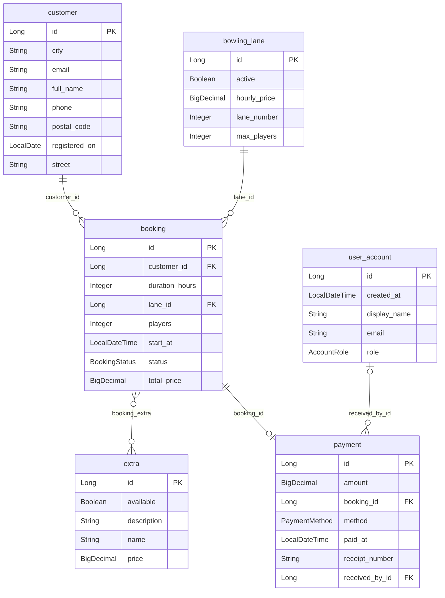

# Schemat bazy danych

Plik generują reguły projektu (panel Maven → Lifecycle → verify). Nie edytujcie go ręcznie.

Tabele: 7 (w tym tabele łączące @ManyToMany: booking_extra) · kolumny: 38 · relacje: 3 × @ManyToOne, 1 × @OneToMany, 1 × @OneToOne, 1 × @ManyToMany

| Tabela | Encja | Kolumny | Klucze obce |
|---|---|---|---|
| booking | Booking | 8 | customer_id, lane_id |
| bowling_lane | BowlingLane | 5 | — |
| customer | Customer | 8 | — |
| extra | Extra | 5 | — |
| payment | Payment | 7 | booking_id, received_by_id |
| user_account | UserAccount | 5 | — |

